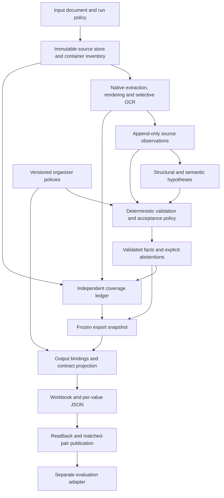

# CarthAgents — final architecture baseline

**Version:** 1.0 · 18 October 2026  
**Status:** approved design baseline, now being implemented. This document records the design before the layout-20 workbook arrived; `template-contract.md` records the subsequently verified destination sheets, field IDs, signs, and formulas. The official JSON schema and scorer remain pending. Test evidence is reported separately.  
**Scope:** unattended extraction of fixed-asset schedules from unfamiliar real client documents, with traceable amounts, explicit uncertainty, completeness checks, and replaceable output adapters.

## 1. Objective and evidence boundary

For each input document, identify every relevant printed amount or genuinely empty amount cell; determine its asset/class, field, period, and business context; preserve its source; and produce the Arbeitsversion workbook plus per-value JSON under the official contract. A plausible amount attached to the wrong row, year, unit, or pointer is a wrong result.

The user confirmed that organizers will use **real client documents** for hidden evaluation. The supplied material is synthetic: 72 documents in 10 families, sharing a generated accounting model. Its layout variations, scans, and answer keys are useful development fixtures, but do not establish robustness on real documents.

**Established by the brief:** code supplies financial figures from PDF text, OCR, or Excel; the model may interpret structure. Every exported value needs a source pointer. Preserve printed errors and flag them. Detail, subtotal, and total amounts count. A genuinely empty amount cell counts as zero. A flagged blank scores 0; a correct value +1; a wrong value −3. Execution must work unattended on a folder of unseen documents.

**Subsequent contract update:** the user supplied Arbeitsversion layout 20 during implementation. It defines `Anlagenverzeichnis`, `Gitter nach Anlagenklasse`, and `Gitter nach Bilanzposition`, with embedded field catalogs. The exact JSON output schema and leaderboard scorer are still unavailable. See `template-contract.md` for resolved workbook details; do not treat the earlier missing-template discussion below as the current inventory.

**Stress evidence so far:** an adversarial design review and two executed analytical probes, not an application stress test. One probe showed that the local helper's absolute-value comparison cannot test sign correctness. The other showed that swapping balanced movements between two assets can preserve every arithmetic equation and aggregate. Neither measures extraction accuracy, runtime, or real-client generalization.

The resulting design prioritizes evidence-backed acceptance and measurable coverage. Abstention is a valid outcome, but an application that abstains everywhere has not met the completeness objective.

## 2. Deployment shape and stable boundaries

Use one **Python application with separate internal modules**, a bounded worker pool, an immutable file/object store, and a local transactional run ledger such as SQLite. This keeps ingestion, retries, evidence, and export snapshots inspectable within a single deployment. External OCR/model calls are bounded capabilities of the runner.

| Module | Responsibility and boundary |
|---|---|
| Run coordinator | Inventory inputs; schedule bounded work; isolate failures; persist checkpoints; publish terminal results. |
| Source store and inventory | Retain original bytes and hashes; enumerate pages, sheets, objects, visibility, and extraction limits. |
| Acquisition | Produce text, cell, geometry, rendering, and OCR observations. It does not assign financial meaning. |
| Structure and interpretation | Propose table regions, logical rows, header paths, contexts, and competing value associations using existing evidence IDs. |
| Validation and acceptance | Parse amounts, verify provenance and dependencies, evaluate ambiguity, run applicable checks, and create facts or abstentions. |
| Coverage | Reconcile a separately built inventory against dispositions; expose omissions and unsupported regions. |
| Fact and run ledger | Store immutable records, dependencies, policy versions, diagnostics, and export snapshots. |
| Contract projection and exporters | Assign target destinations and represent facts under the official schema without changing source facts. |
| Evaluation | Compare submissions with available gold data/scorers; report errors, coverage, calibration, and cost. Gold data never enters runtime extraction. |

Within acquisition, native XLSX reading, PDF text/geometry, rendering, and OCR are replaceable implementations. Library selection is a measured implementation decision; it is not an accuracy guarantee. Initial candidates include openpyxl, PyMuPDF/pdfplumber, and a geometry-preserving OCR engine. Pin exact versions after representative probes.

## 3. Data contracts: three layers, three identities

These are conceptual contracts, not final JSON schemas.

| Record | Essential content | Rule |
|---|---|---|
| `SourceObservation` | Original content hash; page/sheet/member; text or native cell data; coordinate frame; exact locator; acquisition method/version/config; formula/cache/display details where relevant. | Append-only evidence. OCR output is an observation, not verified truth. |
| `HypothesisSet` | Candidate associations and contexts; evidence/counterevidence IDs; dependencies; alternatives including `unknown_unmodeled`; source-sufficiency assessment. | Never exported as a financial fact. |
| `ValidatedFact` | Logical row and granularity; field; context claims; source amount representation; supported normalization; source occurrence; complete validation/provenance closure. | Created as a new record after the required gates. Template-independent. |
| `Abstention` | Known row/field/context where available; candidate region; failure or uncertainty reason; dependent claims; unresolved alternatives. | Represents withheld output. Unknown rows remain coverage items, not invented destinations. |
| `OutputBinding` | Snapshot/fact or abstention IDs; contract version; target row/field/cell or JSON identity; approved representation transforms. | Created separately from facts; cannot redefine their meaning. |
| `CoverageItem` | Independently inventoried region/cell/object, relevance disposition, links to facts or abstentions, unresolved reason. | Must survive even when the semantic mapper misses it. |

Promotion creates a new record and a provenance edge. It never changes an observation into a hypothesis or changes a hypothesis into a fact in place. Later invalidation appends an event and excludes dependent facts from new snapshots; old snapshots remain auditable.

Keep identities separate:

1. **Physical input and occurrence:** original bytes and the exact page/cell/region. Identical uploaded bytes can share cached acquisition, while each delivery retains its own run identity.
2. **Business meaning:** entity, accounting book, asset/class, period, temporal role, field, currency, and unit. Repeated asset IDs across entities or books are distinct contexts.
3. **Output destination:** the row key and field/cell required by the official contract.

Equality in one namespace does not authorize deduplication in another. Repeated numbers, duplicate-looking pages, subtotal occurrences, and PDF/Excel versions remain distinct until an explicit policy addresses them. An asset-class aggregate cannot manufacture asset-level detail. A lowest-level schedule position is not automatically a physical asset.

Preserve source-only fields and unfamiliar labels even if the present field vocabulary or destination has no equivalent. They remain mapped facts if their meaning is established, or unresolved observations otherwise. An exporter must report unmapped facts rather than silently discard them.

## 4. Acquisition preserves the document's evidence

**Inventory before interpretation.** Enumerate every PDF page and Excel sheet, including hidden/very-hidden sheets, filtered/hidden rows, merged regions, formulas, populated cells, and relevant OOXML relationships, drawings, images, or embedded objects. Track what was inspected and what remains unsupported. Bound decompression, page pixels, object counts, styled ranges, and processing time; a truncated inventory cannot claim completeness.

**PDF paths.** Use native text and geometry when reliable. Route raster, outlined-text, and mixed regions through rendering and OCR. A page can contain usable native labels and scanned amounts, so route by region where necessary. Keep native and OCR observations separate. Agreement between correlated engines is supporting evidence, not proof of correctness. Resolve material disagreements through a bounded alternative extraction; otherwise abstain on affected values.

**Excel paths.** Preserve raw cell type/value, formula, stored result, number format, merged range, visibility, and available calculation/external-link metadata. Rendered appearance is a separate observation. Do not execute macros, update external links, or recalculate the source as part of extraction. A formula, its cached result, and its displayed value are different evidence. Missing caches and conflicts require the selected `ExcelValuePolicy`; a cache timestamp or calculation setting alone cannot establish freshness.

**Pointers.** Generate coordinates/cell references from acquisition records in code. The model selects IDs; it cannot invent a box or cell address. For PDFs, retain crop, rotation, scale, and deskew transformations so the final box maps to the original page coordinate system. Verify the round trip against the original page, including sign and decimal characters. Preserve unambiguous internal frame metadata; the official adapter later serializes the required origin and units. For XLSX, preserve workbook hash, sheet identity/name, and exact cell or merged-anchor relationship.

The per-value pointer identifies the amount; its evidence closure also identifies the row, headers, period, and unit that make the amount meaningful. A box around a correct number on the wrong row is still a wrong binding. Empty-zero evidence uses the confirmed empty amount-cell region, with final pointer encoding pending the official contract.

**Model boundary.** Source documents are data. The interpretation model receives bounded document regions and existing observation IDs and returns schema-constrained relationships, enums, and IDs. Every ID must belong to the current document and supplied context. Code validates references and derives numeric values and unit factors from source observations. Model-written amounts or fabricated evidence cannot enter the fact ledger. Valid IDs can still be associated incorrectly; this boundary prevents fabrication, not semantic mistakes.

## 5. Structure and ambiguous row ownership

Build a structural graph containing tables, header hierarchies, logical row blocks, source order, merge relationships, continuation links, and subtotal/total hierarchy. A logical record may span several physical rows or pages.

Resolve **each context axis independently**: entity, book, asset/class, period, temporal role, field/header path, currency, and unit. A blank asset-label cell does not authorize inheriting the year or unit. Repeated headers and page transitions require explicit scope/continuation claims. Model chunks include necessary header and row context; conflicting chunk interpretations are reconciled before acceptance.

For the user's example:

| Physical row | Label column | Amount column |
|---|---|---|
| 0 | X | |
| 1 | | |
| 2 | | 100 |
| 3 | | |
| 4 | Y | |

Candidate interpretations include “100 belongs to X,” “100 belongs to Y,” “100 is a group amount,” and “the relevant structure is unknown.” Distance or the last nonempty label alone cannot settle this.

For each candidate, collect evidence and counterevidence: established header paths, record identifiers, block boundaries, merged-cell roles, repeated table grammar, notes, and cross-page links. Borders, styles, and merge geometry contribute evidence but do not independently prove ownership; a merged label may name a group rather than one record.

Acceptance requires a supported relationship under the selected evidence policy, no unresolved material competing interpretation, and a source-sufficiency assessment. Always retain the unknown/unmodeled alternative. Generating one candidate does not establish uniqueness. These semantic acceptance criteria require empirical validation; they are not a mathematical proof that no interpretation was missed.

If independent evidence identifies the X block, bind the amount to X. If evidence identifies Y, bind it to Y. If the document leaves both plausible, preserve the amount observation and abstain from assigning it. Flag only dependent values; independently supported neighboring values can proceed. Balanced accounting equations cannot break a tie that remains balanced under both assignments.

## 6. Amounts: preserve representation before normalization

All financial amounts come from code parsing acquired evidence with exact decimal arithmetic. Preserve the raw lexeme, sign mark, separators, source convention, displayed magnitude, unit/scale claim, currency claim, and source-signed display value. Retain printed precision. Integer cents are a suitable representation when the source conversion is exact; scaled or rounded source figures retain their original precision metadata.

Examples:

| Source | Preserved interpretation |
|---|---|
| `1.234,56` under an evidenced EUR context | German decimal representation of 1,234.56 EUR; exact 123,456 cents. |
| `184.782,83-` | Trailing-minus signed display value −184,782.83, with the source convention recorded. |
| `12` under an evidenced TEUR header | Displayed 12 thousand EUR; normalized 12,000 EUR with source precision of one TEUR, not recovered hidden cents. |
| `–`, empty, or `N/A` | Distinct observations; their meanings require document and policy evidence. |

**SAP finding.** The supplied SAP generator deliberately stores positive core magnitudes for some fields, including disposals and depreciation, while printing credits with a trailing minus. For example, class 1000 in `f05_sap_class_gitter_01` has a positive key magnitude for opening accumulated depreciation while the PDF representation is `184.782,83-`. The local absolute-value checker therefore cannot verify polarity, but its behavior alone does not establish a checker defect.

Keep the **source-signed amount**, any explicitly derived **domain magnitude**, and the **target amount** separate. A versioned `SignPolarityPolicy` may authorize a reversible conversion. No universal absolute-value operation, field-name heuristic, or balancing equation may silently change a sign. If only the target convention is unknown, the unambiguous source fact can stand while its output binding is `contract_pending`. If the source sign or unit itself is ambiguous, withhold the fact.

A parser must consume the complete numeric representation and detect ambiguous locale, clipped digits, footnotes, OCR sign loss, and inconsistent scale. It may not fix an uncertain digit because a repaired number makes a total balance. Dates, identifiers, and useful-life fields use their own typed parsers; preserve leading zeros and distinguish them from monetary amounts.

**Empty-zero proof.** Distinguish printed zero, confirmed empty amount cell, missing field, unreadable cell, merged follower, formula without a usable result, and explicit not-applicable marker. Accept an implicit zero only when the row and amount-column intersection is positively established, its full region is present, it is not a merged continuation, and applicable acquisition evidence does not show omitted or unreadable content. Absence of extracted text is insufficient. The brief establishes the empty-zero intent; official evidence/pointer encoding remains pending.

## 7. Validation, uncertainty, and source errors

Validation creates a complete binding, not a number with an isolated confidence score. Required dependencies include:

- Amount or empty-cell observation and exact source occurrence.
- Selected association, alternatives, counterevidence, and source-sufficiency result.
- Logical row/granularity and independent entity, book, period, temporal-role, field, unit, and currency claims.
- Parser/sign/scale decisions and applicable source policies.
- Pointer transformation and round-trip result.
- Deterministic checks and the version of the empirical acceptance policy.

Conflicting shared headers or periods invalidate the entire dependent set. Unrelated facts retain their eligibility. No stale accepted record can survive a superseded dependency into a new export snapshot.

Keep status dimensions separate:

| Dimension | Examples |
|---|---|
| Source observation | printed value; explicit zero; confirmed empty; unreadable; unavailable formula result |
| Acceptance | validated; abstained; contract pending; invalidated |
| Source anomaly | none; arithmetic inconsistency; conflicting source representations |
| Coverage | relevant and resolved; relevant but unresolved; evidenced out of scope; scope unknown |
| Run result | complete; partial; failed, with a separate export status |

Checks include parse replay, valid references, pointer containment, context compatibility, supported transformations, applicable row equations, subtotals, totals, and cross-page continuity. Financial equations must match the source's field and sign conventions. They diagnose possible errors; they neither create missing values nor prove row ownership.

If independently mapped source values are 60 + 60 with a printed total of 100, retain the printed 100 and flag `source_inconsistent`. If the association or extraction is uncertain, do not label the discrepancy a client error; abstain on the affected binding until that uncertainty is resolved.

**Acceptance policy.** Use empirical correctness estimates for the complete binding, stratified by extraction path and evidence pattern. Model self-reported confidence is not calibrated probability, and multiplying marginal confidences assumes unjustified independence. Under the brief's simple score, expected value is `4p − 3`, so 0.75 is only a theoretical break-even probability for an already well-defined scoring event. It is not a deployment threshold. Choose conservative thresholds from held-out error/coverage curves and revisit them under distribution shift.

## 8. Completeness is independently accounted for

Create the coverage ledger from the container and structural/numeric inventory before semantic mapping. Include nonempty numeric regions, evidenced amount-grid cells, totals, continuation blocks, and unprocessed objects. The mapper cannot certify its own completeness merely by declaring all of its extracted rows done.

Every inventory item needs a terminal disposition: linked to a fact, linked to an abstention, evidenced irrelevant/out of scope, or unresolved/unsupported. Unknown relevance remains unresolved. A page that fails rendering, a hidden sheet whose scope is unknown, or an unprocessed embedded schedule prevents a complete result. Runtime coverage is still an estimate of discovery; only independent annotation can reveal items missed by both inventory and mapping.

Report separately:

- Inventory coverage: inspected versus skipped/failed regions and objects.
- Resolution coverage: evidenced relevant slots assigned facts or explicit abstentions.
- Accepted-value coverage: accepted values divided by independently established relevant slots, when that denominator is available.
- Wrong accepted values, missing slots, and correct abstentions on evaluation data.

Zero wrong values at near-zero accepted coverage is not success. A resolved abstention means uncertainty was reported, not that extraction succeeded. Mark a document complete only when all in-scope inventory is accounted for under a known scope policy; expose its abstentions even then. If discovery remains unresolved, mark it partial.

## 9. Flexible contracts without flexible truth

All policy choices are explicit and versioned. A policy may encode a rule already established by the brief; it must never hide a guessed organizer decision.

| Policy or adapter | Responsibility | Pending organizer detail |
|---|---|---|
| `InputScopePolicy` | Eligible files, regions, visibility, objects, and document roles | Word/DOCX; hidden/filtered content; embedded schedules; duplicate versions. |
| `ExcelValuePolicy` | Authority of raw values, stored formula results, and rendered displays | Cache/display conflicts, rounded formats, unavailable formula results. |
| `EmptyZeroPolicy` | Distinguish confirmed empty zero from unavailable/unknown | Accepted blank-region evidence and special markers. |
| `SignPolarityPolicy` | Explicit source-to-domain/target polarity transforms | Signed display versus positive field magnitude. |
| `PointerPolicy` | Source-coordinate serialization and validation | Coordinate conventions, tolerance, blank regions, merged cells. |
| `DestinationIdentityPolicy` | Output row identity and allowed occurrence handling | Entity/book/period keys; totals; repeated records; cross-tab mapping. |
| `OutputContract` and `ExportAdapter` | Workbook structure, JSON schema, representation and flags | Official template/schema; field units, precision, missing/blank encoding. |
| `ScorerAdapter` | Evaluate artifacts with official matching/scoring behavior | Scorer code, matching rules, penalties, and pointer tests. |

If a missing policy affects source interpretation, the dependent fact is pending/withheld. If it affects only destination representation, source facts remain available and the output binding is pending. Unrelated work proceeds. Changes to source policies invalidate and replay dependent facts; changing a column position only rebuilds output bindings/exports.

Contract projection consumes a frozen fact/abstention/coverage snapshot. It may apply approved representation transforms, assign destinations, and format values. It cannot reread sources, resolve ambiguity, mutate facts, infer missing detail, or invent totals. Diagnostics may calculate expected totals, but derived figures are not submitted as printed-source values. Any future request for derived output requires a separate explicit contract and lineage type.

If the official schema cannot represent two distinct source contexts or a source-only field, report a mapping conflict or unsupported projection. Do not collapse data to make the workbook fit. Totals and subtotals remain source facts until their destination is specified.

Before the official artifacts arrive, the system can expose its internal evidence/fact ledger and a clearly provisional review workbook. Those are development artifacts, not claimed compliant submissions. Ground-truth key structure is not the official schema. Keep evaluation keys and generator code outside the runtime's input allowlist.

When the artifacts arrive: inspect their capabilities; record exact versions/hashes; resolve policy differences; implement the projection; run contract fixtures and the scorer; then re-evaluate affected facts and acceptance thresholds. The source store, acquisition records, and structural evidence remain reusable.

## 10. Unattended execution, replay, and publication

Each input has an independent state machine: registered → inventoried → acquired → interpreted → validated → snapshotted → exported → publication verified. Region-level failures can yield partial results; fatal source or persistence failures yield a failed result. A failure must have a terminal reason. Unsupported inputs must not disappear silently.

Bound document size, decompression, pixels, table range, chunks, concurrency, retries, model/OCR calls, cost, and wall time. Select numerical limits from the execution environment and benchmarks. Retry transient failures with capped attempts. A timeout or provider outage creates explicit unresolved work and allows other inputs to proceed. No step waits for a human during the challenge run.

Persist checkpoints and stable job IDs. Cache using original content hash, region/coordinate transform, acquisition configuration, parser/model versions, prompt/schema, and relevant policy dependencies. Keep document/client namespaces and prevent foreign evidence IDs. Record actual model responses; replaying recorded responses is reproducible, while a fresh model request is not guaranteed identical.

For every fact, replay must reproduce its source representation, semantic binding, status, and complete dependency closure from original bytes plus recorded observations, responses, versions, and policies. A changed header claim or source policy invalidates dependent results even if the numeric text is unchanged.

Generate the workbook and JSON from **one immutable snapshot**. Read both back and compare values, destinations, pointers, flags, and row counts against that snapshot. Build in a staging location, then publish the matched pair together, using an atomic directory handoff where supported. If the official folder layout requires flat files, use an agreed completion marker or runner-controlled handoff so consumers cannot observe a half-written pair. Keep internal manifests outside official schemas unless permitted.

Protect source files, preserve local-only challenge data exclusions, and send documents only through configured processing providers under the organizer's data-handling rules. Provider authorization for real client data and network availability are deployment inputs to confirm; the design supports a local OCR/model path if required. Logs should reference source IDs and diagnostics without unnecessarily duplicating client contents.

## 11. Scenario decisions carried into this design

| Case | Required behavior |
|---|---|
| Clear one-row asset with native numbers | Bind through evidenced row/header context; parse in code; emit an exact source pointer. |
| X/Y with a value between labels and blank rows | Evaluate competing ownership including unknown; accept only supported association; otherwise abstain. |
| Multiline/merged SAP block | Identify the logical block and field per subrow; preserve merge semantics and source signs. |
| Two years, local TEUR override, or another entity on the same page | Resolve period/unit/entity independently; invalidate the dependent block if a scope is uncertain. |
| Same asset number in two books or repeated summary/detail reports | Preserve distinct contexts and source occurrences; apply only an explicit destination policy. |
| Genuine empty amount cell versus failed OCR | Confirm the cell region before zero; unreadable or unobserved remains withheld. |
| Printed totals do not add up | Preserve independently mapped source values and flag the inconsistency; never repair them. |
| Wrong row assignment still balances | Arithmetic cannot authorize it; association evidence decides or causes abstention. |
| Formula cache missing/stale or display disagrees with raw Excel | Preserve all representations; apply the explicit policy; never silently recalculate or choose. |
| Mixed raster/native PDF, rotated page, clipped sign | Preserve independent extraction paths and transforms; verify original-page pointers; abstain if material disagreement persists. |
| Hidden sheet, embedded image, giant styled range, or failed page | Inventory and bound work; unknown relevance/unprocessed regions produce partial coverage. |
| Prompt injection or schema-valid wrong evidence selection | Reject out-of-scope actions/IDs; assess valid-ID semantic errors through association gates and adversarial tests. |
| Worker crash or provider timeout during export | Resume from checkpoints; preserve independent results; publish only a verified matched pair. |

## 12. Verification plan and implementation entry criteria

The following are acceptance requirements for future implementation, not tests that have passed.

**Deterministic gates:** immutable-source hashes; valid document-local references; exact parser replay including sign/scale/precision; explicit empty-zero evidence; dependency invalidation; coordinate round trips; no hypothesis leakage into exports; policy-version isolation; matched export readback; bounded failure and resume; no runtime access to gold keys.

**Empirical gates:** correct row ownership, context and field mapping, OCR accuracy, unknown-layout handling, evidence sufficiency, blank detection, and independent coverage. Evaluate the complete tuple—value, field, row/context, period, unit, and pointer—rather than value text alone.

Build a labeled challenge suite with clear positive controls and deliberately unresolvable cases. Include spatial ambiguity; incorrect but balancing associations; nested/continued headers; mixed languages/locales; SAP polarity; scale/rounding; scans and outline PDFs; formula/cache/display differences; hidden and embedded content; duplicate IDs/versions; source errors; malformed/large inputs; prompt injection; crashes; and interrupted pair publication. Expected output for an unresolvable case is abstention, not a forced hidden-label guess.

Add invariance checks: irrelevant spacing, blank rows, or page breaks should not change an established mapping; changing a unit header should invalidate/recompute exactly its dependency set; reordering independent documents should not change results. Pointer tests must include repeated equal numbers so a wrong location cannot pass on amount text alone.

Separate development, threshold calibration, and locked evaluation by generator/client/layout lineage. Correlated PDF/XLSX/scan variants of the same generated records belong in one split. The supplied families already inspected in this analysis are development data, not an untouched final holdout. Use newly created independent fixtures and organizer-held real documents for credible generalization evidence.

Report accepted-value precision, coverage and omissions, abstention quality, pointer errors, wrong row/year/unit/sign rates, score under the available contract, and latency/cost/resource limits. Break results down by acquisition path and failure class. A locally passing suite cannot prove performance on all real client data; the official hidden evaluation is still needed.

**Implementation sequence, when authorized:** establish records/invariants and native extraction; add semantic binding and ambiguity cases; add OCR and spreadsheet edge paths; implement validation/coverage/replay; add official contract projection when available; then run independent adversarial evaluation and calibrate acceptance. Keep each stage runnable and measurable. No code is authorized by this design document itself.

## 13. Decisions frozen and decisions intentionally open

**Frozen architectural choices:** bounded modular monolith; immutable observations; non-exportable hypotheses; template-independent facts; separate physical/business/output identities; code-only figure parsing; open-world associations; per-axis context; reversible amount representations; dependency-aware validation; independent coverage; frozen export snapshots; explicit policies; separate evaluation.

**Open contract choices:** official workbook/JSON destinations and identity; sign/precision representation; formula/display precedence; blank/pointer details; hidden/embedded/Word scope; duplicate handling; scorer matching. **Open empirical choices:** OCR/model configurations, evidence thresholds, and resource budgets. These have named owners in the design rather than guessed defaults.

The architecture is ready to guide implementation planning. Official submission compatibility and real-client robustness remain unvalidated until the missing contracts and empirical evidence are available.

**Independent design review:** all eight gates passed against this document: layer/identity separation; association sufficiency; reversible sign/unit/period interpretation; explicit policy interfaces; replay and export consistency; independent coverage; bounded partial failure; and accurate limits on readiness claims. These are document-review results, not executed application checks.

## Evidence and supporting material

- Challenge requirements: `TUM-ai-Challenge-Brief-CarthAgents-detailed.pdf`, pages 1–2, in the local challenge package.
- Local-only supporting audits are stored under `hackathon-local/analysis/`: `corpus-audit.md`, `architecture-analysis.md`, `architecture-stress-test.md`, and `stress-counterexamples.json`. They are excluded from Git. This baseline supersedes earlier architectural wording; its SAP sign clarification governs interpretation of the absolute-value probe.
- SAP evidence in the private corpus: `_generator/families/_sap_common.py`, sign-convention docstring and `NEG`; `f05_sap_class_gitter/f05_sap_class_gitter_01.key.json` and its associated PDF. Runtime code must never read these evaluation keys or generator files.
- Primary library documentation: [openpyxl Excel reader and data-only behavior](https://openpyxl.readthedocs.io/en/stable/api/openpyxl.reader.excel.html), [formula handling](https://openpyxl.readthedocs.io/en/stable/simple_formulae.html), [PyMuPDF page coordinates](https://pymupdf.readthedocs.io/en/latest/page.html), [OCR support](https://pymupdf.readthedocs.io/en/latest/recipes-ocr.html), [pdfplumber geometry](https://github.com/jsvine/pdfplumber).
